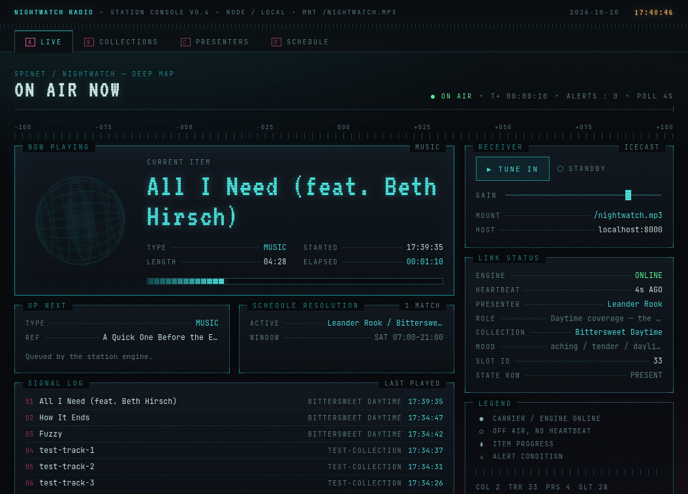

# Nightwatch Radio

A personal, local AI-powered internet radio station. Four AI presenters —
Cassius Thorne, Thaddeus Crake, Lucan Wormhald, and Leander Rook — take
shifts across the day and night, introducing songs, reading the hour's news
and weather, handing off between collections, and signing off, all written
live by Claude and spoken by ElevenLabs. Music crossfades under LiquidSoap,
punctuated by an ambient radio-static effect, and streams over Icecast to a
retro, CRT-styled console.

The vibe it's chasing: the resistance-radio scene in *Harry Potter and the
Deathly Hallows — Part 1*, the one scored by Nick Cave — hushed, intimate,
a little static-worn. ("O Children" made it into one of the station's own
playlists.)



## Architecture

```
liquidsoap/           playback engine (LiquidSoap scripts)
  radio.liq              pull (music) + push (AI speech) graph, crossfade,
                          dual output (local monitor + Icecast)
  static_fx.liq           ambient static/fuzz effect, layered on the
                          combined output

apps/engine/           the station's "brain" — a long-running Node process
  src/scheduler/          resolves who's on air from the DB, rolls the
                          7-moment-type trigger rules, pre-renders ahead
                          of air time, writes live status
  src/generation/         Claude (script) + ElevenLabs Flash (voice)
  src/providers/          mock news/weather, swappable for real APIs later
  src/server.ts            HTTP: /next-music (LiquidSoap pulls from this),
                          /trigger/<type>, /schedule/now, /health

apps/web/               SvelteKit station console (CRT/retro UI)
  routes/live              on-air HUD, embeds the Icecast stream
  routes/collections       playlist CRUD + mp3 upload (ffprobe duration,
                          ID3 tags, sha256 dedupe)
  routes/presenters        persona CRUD (name, system prompt, voice ID)
  routes/schedule           weekly / date-override schedule_slots CRUD

packages/db/             shared SQLite schema (node:sqlite), used by both
                        apps/engine and apps/web — the database is the only
                        source of truth for presenters and schedule; the
                        engine re-reads it fresh every scheduler tick, so
                        edits made in the UI take effect on the next clip

audio/library/<name>/   uploaded mp3s, one directory per collection
audio/generated/        cached TTS clips (logged in generated_clips)
data/airadio.sqlite3    the database
```

**How a line actually gets on air:** the engine decides a moment should
happen (hourly, on a collection change, probabilistically between songs),
writes a `generated_clips` row, asks Claude for a script in the active
presenter's voice, asks ElevenLabs Flash to render it, and — once it's
ready — pushes the file into LiquidSoap's `inject` queue over telnet.
LiquidSoap combines that push-based speech queue with a pull-based music
source (it calls back into `/next-music` whenever it needs a new track) via
`fallback(track_sensitive=false, ...)`, with crossfade applied to each
source individually before combining — the `track_sensitive=false` is what
lets a pushed clip land at the next track boundary without ever interrupting
a crossfade in progress. The static effect wraps the whole combined output
and doesn't know or care whether music or speech is currently playing.

## Technical details

- **Dev environment**: a Nix flake (`flake.nix`) provides everything —
  LiquidSoap 2.4.5, Icecast 2.5.0, Node 22, pnpm, sqlite, ffmpeg — so
  `nix develop` is the only prerequisite. Nothing touches global config.
- **Database**: SQLite via Node's built-in `node:sqlite` (no native
  bindings to compile). Core tables: `presenters`, `collections`, `tracks`,
  `schedule_slots`, `generated_clips` (the TTS cache + status lifecycle:
  `pending → rendering → ready → used`/`failed`), `station_state` (the
  singleton row the live UI polls), `news_items` / `weather_snapshots`
  (mock data behind a `NewsProvider`/`WeatherProvider` seam, so a real API
  is a drop-in swap later).
- **Scheduling**: `schedule_slots` supports `weekly` (day-of-week +
  time range) and `date_override` (a specific date, higher priority)
  recurrence. A 5-second scheduler tick resolves who's on air, detects
  presenter/collection changes, and fires the 7 moment types — song intro,
  collection changeover, top-of-hour open, news, weather, sign-off, and
  filler one-liners — at the priority order sign-off > changeover >
  hour-triad > probabilistic intro/filler, pre-rendering each clip ahead of
  its delivery deadline so there's no dead air waiting on API latency.
- **AI**: Claude (Sonnet) writes every script from a per-presenter system
  prompt plus a trigger-specific template (time, collection, song metadata,
  or raw news/weather data to relay verbatim); ElevenLabs Flash renders it.
  Each presenter's voice is picked independently in the ElevenLabs
  dashboard and stored as `presenters.elevenlabs_voice_id`.
- **No streaming infrastructure beyond Icecast** — this is a local station.
  LiquidSoap's output stage is additive, so a remote relay would be a pure
  addition later, not a rework.

## Usage

```sh
nix develop                              # everything below assumes this shell

cp .env.example .env                     # fill in ANTHROPIC_API_KEY,
                                          # ELEVENLABS_API_KEY, ICECAST_SOURCE_PASSWORD
pnpm install

scripts/start-icecast.sh &               # local Icecast, config is generated
liquidsoap liquidsoap/radio.liq &        # playback engine
pnpm --filter @airadio/engine start &    # scheduler + AI pipeline
pnpm --filter @airadio/web dev           # station console, http://localhost:5173
```

Tune in at `http://localhost:8000/nightwatch.mp3`, or just open `/live` in
the console — it embeds the stream directly. Upload music and edit
presenters/schedule from `/collections`, `/presenters`, `/schedule`; changes
apply on the next scheduler tick, no restart needed.

## Development workflow

This project was built conversationally with Claude Code, end to end —
worth documenting because the *process* shaped the result as much as any
individual decision did.

**Planning first, in plan mode.** The initial request — AI DJs, a
melancholic resistance-radio vibe, LiquidSoap, a schedule, an upload
interface — was broad enough to need real architectural decisions before
any code: SvelteKit vs. a native GPUI app, mock vs. real news/weather data
for v1, how many presenters to design up front, whether the static effect
should be transition-only or ambient. Rather than guessing, each of these
went through `AskUserQuestion` with a recommendation attached, and a
dedicated planning pass (background research into LiquidSoap's actual
request-queue/crossfade semantics, not assumed from general knowledge)
produced a phased build order before any file existed.

**The UI's look came from references, not a brief.** The user dropped
eleven images into `ui-reference-images/` — a deep-space tracking HUD, a
DOS-era terminal, a cassette J-card, vintage weather broadcasts — with no
further explanation. Those were read as images, synthesized into a design
language (numbers-station / listening-post / cassette-left-in-a-drawer),
mapped onto concrete UI regions, and confirmed ("apply everywhere,
including forms, or just showcase views?") before `apps/web` was scaffolded.

**Verification was empirical, not assumed.** Throughout, claims about
behavior were checked by capturing the actual Icecast stream with `ffmpeg`
and analyzing it (`astats`, `silencedetect`, `volumedetect`) — because an
agent can't listen, so "it compiles" was never treated as "it works." This
caught real bugs: a LiquidSoap crossfade-after-queue-push regression that
turned out *not* to be present (proven by analyzing 24 crossfade events
around live injections), and a static-effect timing bug where the state
machine's internal clock silently drifted behind wall-clock time under
load, found by noticing a measured gap exceeded its configured maximum and
fixed by switching to real elapsed-time measurement instead of an assumed
tick duration.

**Parallel work, once it was safe to parallelize.** Phases were built
sequentially up through the database schema (scaffolding → LiquidSoap
baseline → schema), then two independent background agents took Phase 2
(the engine's AI pipeline) and Phase 4 (the SvelteKit UI) at the same time,
since both only depended on the now-stable schema, not on each other. Each
was independently verified — the engine via live stream capture/analysis,
the UI via screenshots checked against the reference images and a real
upload exercised end to end — then reconciled and merged. Phase 3 (the full
scheduler) followed the same pattern once presenters and schedule existed
to resolve against, proving itself against a simulated compressed broadcast
day (27/27 checks) plus live delivery of all seven moment types.

**Iteration stayed conversational after the architecture settled.**
Presenter voices were chosen by generating in-character sample lines for
the user to audition in ElevenLabs directly; renames and a fourth,
daytime-only presenter were slotted in without re-planning; the static
effect was redesigned twice from listening feedback alone ("sounds like
rain," then later confirmed "crackle is sounding great"); a schedule bug
(only one of seven weekly day-rows had actually been updated after a UI
edit) was caught by direct database inspection rather than trusting the
user's "it's working" at face value — confirmed, found the gap, fixed it,
said so.
